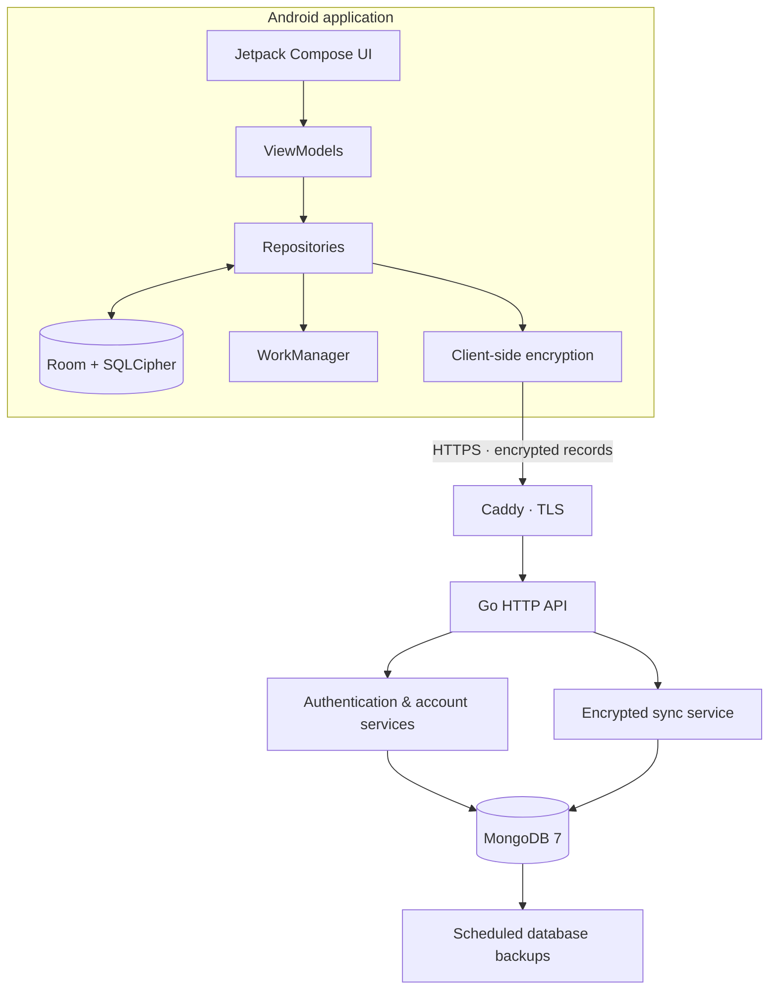

<div align="center">


# Cidna · سیدنا

### Your money. Your picture. Your control.
### تصویر روشن‌تری از پولت؛ با کنترل بیشتر.

**A privacy-first personal finance companion for Android.**  
**همراهی برای مدیریت مالی شخصی؛ با اولویت حریم خصوصی و تجربه‌ای بومی.**

[Website](https://cidna.ir) · [فارسی](#فارسی) · [English](#english) · [Technology](#technology) · [Security](#امنیت-و-حریم-خصوصی) · [License](#license)

[](LICENSE)


</div>

---

<a id="فارسی"></a>

## فارسی

<div dir="rtl" align="right">

# سیدنا؛ مدیریت مالی، فراتر از ثبت هزینه‌ها

پول فقط عددی در حساب بانکی نیست؛ مجموعه‌ای از انتخاب‌های روزمره، هدف‌های آینده، تعهدها و اولویت‌هاست. وقتی درآمدها، هزینه‌ها، بدهی‌ها و پس‌اندازها در جاهای مختلف پراکنده باشند، به‌دست‌آوردن یک تصویر قابل‌اعتماد از وضعیت مالی دشوار می‌شود.

**سیدنا (Cidna)** یک همراه مدیریت مالی شخصی برای اندروید است که این تصویر را در یک فضای یکپارچه جمع می‌کند: از ثبت درآمد و هزینه تا بودجه‌بندی، پس‌انداز، بدهی و طلب، تحلیل مالی و تهیه خروجی.

اما تفاوت سیدنا فقط در تعداد امکانات نیست؛ محصول با سه اصل طراحی شده است:

- **شروع بدون اصطکاک:** برای شروع استفاده روزمره لازم نیست ابتدا حساب بسازید.
- **حریم خصوصی از ابتدا:** داده‌های مالی در دستگاه رمزنگاری می‌شوند و برای همگام‌سازی نیز پیش از ارسال رمزنگاری سرتاسری دارند.
- **تجربه بومی و منعطف:** فارسی و انگلیسی، راست‌چین و چپ‌چین، تقویم جلالی و میلادی و نمایش تومان و ریال.

> **وعده محصول:** کمک می‌کنیم بدانید پولتان کجا می‌رود، برای چه چیزی کنار گذاشته می‌شود و چه تعهدهایی پیش روی شماست؛ بدون آنکه مدیریت مالی به کاری پیچیده و وقت‌گیر تبدیل شود.

## چرا سیدنا؟

| چالش روزمره | پاسخ سیدنا |
|---|---|
| نمی‌دانم درآمدم کجا خرج می‌شود | ثبت و دسته‌بندی درآمدها و هزینه‌ها و مشاهده سوابق |
| برای هر هدف پس‌انداز باید جداگانه حساب‌وکتاب کنم | قلک‌ها و اهداف پس‌انداز با امکان ثبت و پیگیری عملیات |
| سقف هزینه‌هایم از دستم خارج می‌شود | تعیین محدودیت بودجه برای دسته‌بندی‌ها و پیگیری میزان مصرف |
| بدهی‌ها و طلب‌ها را فراموش می‌کنم | ثبت بدهی و طلب، پرداخت‌های جزئی، سررسید و یادآوری |
| اپلیکیشن‌ها با زبان و تقویم من هماهنگ نیستند | رابط فارسی و انگلیسی، RTL/LTR و تاریخ جلالی و میلادی |
| نمی‌خواهم برای امتحان یک اپلیکیشن حساب بسازم | شروع در حالت مهمان و تصمیم‌گیری درباره ساخت حساب در زمان دلخواه |
| نمی‌خواهم سوابق مالی‌ام به‌سادگی قابل‌خواندن باشند | پایگاه داده محلی رمزنگاری‌شده و رمزنگاری سرتاسری سوابق همگام‌سازی‌شده |

## امکانات؛ از ثبت روزانه تا تصویر جامع مالی

### ۱. درآمد و هزینه؛ ثبت ساده، مرور دقیق

- ثبت تراکنش‌های درآمد و هزینه
- ثبت عنوان، مبلغ، دسته‌بندی، تاریخ و توضیحات
- ورود متن با صدا از طریق قابلیت تشخیص گفتار دستگاه
- میان‌برهای ثبت و دسترسی سریع به عملیات پرتکرار
- مرور، ویرایش و مدیریت سوابق تراکنش‌ها
- کارت تصویری تراکنش برای اشتراک‌گذاری

### ۲. دسته‌بندی‌ها؛ متناسب با شیوه مدیریت شما

- دسته‌بندی‌های پیش‌فرض برای شروع سریع
- ساخت و ویرایش دسته‌بندی‌های شخصی
- انتخاب آیکون و نماد برای دسته‌بندی‌ها
- پیشنهاد دسته‌بندی و دسترسی سریع به موارد پرکاربرد
- تفکیک دسته‌بندی‌های درآمد و هزینه

### ۳. بودجه‌بندی؛ کنترل آگاهانه‌تر هزینه‌ها

- تعریف سقف هزینه برای دسته‌بندی‌ها
- تعیین بازه زمانی و تاریخ پایان محدودیت
- مشاهده میزان مصرف بودجه
- پیگیری وضعیت محدودیت‌ها و دریافت اعلان‌های مرتبط

### ۴. پس‌انداز و قلک‌ها؛ هدف را قابل‌پیگیری کنید

- تعریف هدف‌های مالی و قلک‌های جداگانه
- تعیین مبلغ هدف
- ثبت واریز و برداشت
- مشاهده پیشرفت هر هدف
- پشتیبانی از واریزهای ماهانه زمان‌بندی‌شده
- انتخاب آیکون و ظاهر اختصاصی برای هدف‌ها

### ۵. بدهی و طلب؛ تعهدها را فراموش نکنید

- ثبت مبالغ بدهکاری و طلبکاری
- ثبت طرف حساب و اطلاعات مرتبط
- تعریف سررسید
- ثبت پرداخت‌ها و دریافت‌های جزئی
- مشاهده مانده تعهد
- یادآوری موعدهای سررسید

### ۶. تحلیل مالی؛ تصمیم بر پایه تصویر روشن‌تر

- مشاهده خلاصه وضعیت مالی
- نمودارها و شاخص‌های مالی
- بررسی روند درآمد و هزینه
- فیلتر و مرور اطلاعات در بازه‌های زمانی
- پشتیبانی از نمایش تاریخ در تقویم انتخابی برنامه

### ۷. خروجی و اشتراک‌گذاری

- تهیه گزارش PDF
- خروجی صفحه‌گسترده XLSX
- انتخاب دوره گزارش
- اشتراک‌گذاری کارت تصویری تراکنش
- هماهنگی خروجی‌ها با زبان و جهت نوشتار برنامه در بخش‌های پشتیبانی‌شده

### ۸. تجربه و شخصی‌سازی

- رابط فارسی و انگلیسی
- پشتیبانی از چیدمان راست‌چین و چپ‌چین
- تقویم جلالی و میلادی
- نمایش مبالغ به تومان یا ریال
- پوسته روشن و تاریک
- ویجت موجودی در صفحه اصلی اندروید
- امکان مخفی‌کردن مبالغ
- اعلان‌ها و یادآورها
- قفل برنامه و ورود زیست‌سنجی اختیاری

## شروع استفاده؛ بدون اجبار به ساخت حساب

یکی از تصمیم‌های اصلی طراحی سیدنا این است که **ساخت حساب، پیش‌شرط تجربه محصول نیست.**

1. برنامه را نصب و اجرا کنید.
2. بدون ثبت‌نام، در حالت مهمان اطلاعات مالی خود را ثبت کنید.
3. هر زمان به همگام‌سازی چنددستگاهی نیاز داشتید، حساب کاربری بسازید.
4. در فرایند ساخت حساب، درباره انتقال اطلاعات مهمان به حساب جدید یا شروع با اطلاعات خالی تصمیم بگیرید.
5. برای محافظت از امکان بازیابی، کلید بازیابی نمایش‌داده‌شده در فرایند ثبت‌نام را در محل امن نگهداری کنید.

### دو شیوه نگهداری اطلاعات

| حالت | توضیح |
|---|---|
| **محلی / مهمان** | اطلاعات روی همان دستگاه نگهداری می‌شوند و برای استفاده روزمره به حساب آنلاین نیاز ندارید. |
| **حساب‌دار / همگام‌سازی** | با ساخت حساب می‌توانید داده‌های رمزنگاری‌شده را میان دستگاه‌های خود همگام‌سازی کنید. |

### پشتیبان‌گیری مستقل از حساب

سیدنا علاوه بر همگام‌سازی حساب، امکان تهیه و بازیابی فایل پشتیبان محلی را نیز دارد:

- فایل پشتیبان با گذرواژه مستقل محافظت می‌شود.
- رمزنگاری فایل با PBKDF2-HMAC-SHA256 و AES-256-GCM انجام می‌شود.
- فایل پشتیبان به Android Keystore وابسته نیست؛ بنابراین برای بازیابی پس از نصب مجدد یا روی دستگاه دیگر طراحی شده است.
- هنگام واردکردن نسخه پشتیبان، داده‌های موجود به‌صورت مخرب و یک‌جا حذف نمی‌شوند؛ رکوردها بر اساس شناسه و زمان ویرایش ادغام می‌شوند.

**نکته مهم:** فایل پشتیبان را در محل امن نگهداری کنید و گذرواژه آن را فراموش نکنید. بدون گذرواژه، محتوای فایل قابل بازیابی نیست.

## امنیت و حریم خصوصی

حریم خصوصی در سیدنا یک پیام تبلیغاتی صرف نیست؛ بخشی از طراحی ذخیره‌سازی، همگام‌سازی و احراز هویت است.

### حفاظت روی دستگاه

- پایگاه داده محلی Room با SQLCipher رمزنگاری می‌شود.
- کلید پایگاه داده به‌صورت تصادفی تولید و با سازوکار متکی بر Android Keystore محافظت می‌شود.
- اطلاعات حساس نشست و کلیدها در فضای ذخیره‌سازی رمزنگاری‌شده نگهداری می‌شوند.
- قفل صفحه برنامه و ورود زیست‌سنجی اختیاری در دسترس است.
- تنظیمات امنیت صفحه از `FLAG_SECURE` برای محدودکردن اسکرین‌شات و نمایش محتوای برنامه در صفحه برنامه‌های اخیر استفاده می‌کند؛ رفتار آن از تنظیمات برنامه قابل تغییر است.

### رمزنگاری سرتاسری همگام‌سازی

- رکوردهای مالی پیش از ارسال به سرور رمزنگاری می‌شوند.
- رمزنگاری رکوردها با AES-256-GCM و کلید داده تصادفی انجام می‌شود.
- کلید داده به‌صورت بسته‌بندی‌شده نگهداری می‌شود.
- کلید بسته‌بندی از گذرواژه روی دستگاه مشتق می‌شود و خود کلید بسته‌بندی به سرور ارسال نمی‌شود.
- پروتکل مشتق‌سازی کلید نسخه ۲ از PBKDF2-HMAC-SHA256 با ۶۰۰٬۰۰۰ تکرار و HKDF استفاده می‌کند.
- کلید بازیابی نیز از همین اصل جداسازی کلیدها پیروی می‌کند؛ سرور proof مشتق‌شده را دریافت می‌کند، نه خود کلید بازیابی را.

### حفاظت از حساب و نشست

- ذخیره مقدار احراز هویت مشتق‌شده به‌صورت هش Argon2id در سرور
- توکن دسترسی JWT با عمر محدود
- چرخش توکن نوسازی و تشخیص استفاده مجدد
- محدودیت تلاش برای OTP و ورود
- محدودسازی نرخ درخواست‌ها
- امکان مشاهده دستگاه‌های متصل و خروج از نشست دستگاه
- اعلان رویدادهای امنیتی مرتبط با دستگاه جدید

### شفافیت درباره محدودیت‌ها

برای جلوگیری از برداشت نادرست، دامنه حفاظت را دقیق بیان می‌کنیم:

- رمزنگاری سرتاسری برای **سوابق مالی همگام‌سازی‌شده** اعمال می‌شود؛ این به معنی ناشناس‌بودن کامل حساب یا «Zero-Knowledge بودن همه اطلاعات» نیست.
- اطلاعاتی که برای ارائه سرویس لازم‌اند، مانند شماره تلفن و برخی فراداده‌های حساب و دستگاه، در سمت سرویس قابل پردازش‌اند.
- گذرواژه و کلید بازیابی به شکل خام به سرور ارسال نمی‌شوند؛ بااین‌حال، گذرواژه ضعیف می‌تواند ریسک حدس آفلاین را افزایش دهد. از گذرواژه‌ای بلند و منحصربه‌فرد استفاده کنید.
- اگر هم گذرواژه و هم کلید بازیابی را از دست بدهید، داده‌های همگام‌سازی‌شده قابل رمزگشایی و بازیابی نخواهند بود.
- حذف حساب ابتدا نرم است: نشست‌ها باطل می‌شوند و حساب تا ۳۰ روز امکان بازیابی دارد؛ پس از آن فرایند پاکسازی دائمی اجرا می‌شود.
- استفاده از کتابخانه‌های رمزنگاری به‌تنهایی معادل ممیزی امنیتی مستقل نیست.

**گزارش آسیب‌پذیری:** لطفاً جزئیات مشکلات امنیتی را در Issue عمومی منتشر نکنید. برای هماهنگی گزارش خصوصی با تیم پروژه تماس بگیرید: `cidna.app@gmail.com`.

## معماری در یک نگاه



**اصل معماری:** برنامه اندروید برای ثبت و مشاهده داده‌های روزمره به پایگاه داده محلی متکی است. بک‌اند مسئول حساب کاربری، احراز هویت، مدیریت دستگاه‌ها و نگهداری داده‌های رمزنگاری‌شده برای همگام‌سازی است.

## فناوری‌های استفاده‌شده

| لایه | فناوری |
|---|---|
| زبان اندروید | Kotlin 2.2.10 |
| رابط کاربری | Jetpack Compose و Material 3 |
| معماری کلاینت | ViewModel، Repository و `AppContainer` دستی |
| پایگاه داده محلی | Room |
| رمزنگاری پایگاه داده | SQLCipher |
| نگهداری امن کلیدها | Android Keystore و AndroidX Security Crypto |
| کارهای پس‌زمینه | WorkManager |
| ویجت | Jetpack Glance |
| احراز هویت زیست‌سنجی | AndroidX Biometric |
| خروجی Excel | fastexcel |
| بک‌اند | Go 1.26 |
| HTTP routing | chi |
| احراز هویت API | JWT |
| هش رمز | Argon2id |
| پایگاه داده سرور | MongoDB 7 |
| محدودسازی نرخ | Token bucket درون‌حافظه‌ای |
| استقرار | Docker Compose و Caddy |

## ساختار مخزن

```text
BudgetManagement/
├── app/
│   ├── src/main/          # برنامه اندروید
│   ├── src/debug/         # تنظیمات مخصوص نسخه توسعه
│   ├── src/test/          # تست‌های واحد
│   ├── src/androidTest/   # تست‌های دستگاه و یکپارچگی
│   └── schemas/           # اسکیماهای Room
├── backend/
│   ├── cmd/
│   │   ├── api/           # ورودی سرویس API
│   │   └── purge-deleted/ # پاکسازی دائمی حساب‌های منقضی
│   ├── internal/
│   │   ├── domain/
│   │   ├── usecase/
│   │   ├── infrastructure/
│   │   └── interface/http/
│   └── deployments/       # Docker، Compose، Caddy و بکاپ
├── cidna-website/         # وب‌سایت و محتوای حقوقی محصول
├── gradle/
├── ADMIN_CONSOLE.md
├── LICENSE
└── README.md
```

## راه‌اندازی برای توسعه‌دهندگان

### پیش‌نیازها

- Android Studio سازگار با نسخه Android Gradle Plugin پروژه
- JDK سازگار با Gradle و Android Gradle Plugin
- Android SDK و ابزارهای Build متناسب با `compileSdk`
- Docker Engine و Docker Compose v2 برای اجرای بک‌اند
- Go مطابق نسخه تعریف‌شده در `backend/go.mod` برای اجرای مستقیم بک‌اند
- شبیه‌ساز یا دستگاه اندرویدی با Android 8.0 (API 26) یا بالاتر

### دریافت پروژه

```bash
git clone <YOUR_REPOSITORY_URL>
cd BudgetManagement
```

### اجرای بک‌اند در محیط توسعه

```bash
cd backend/deployments

# ساخت فایل تنظیمات توسعه
cp ../.env.example .env

# مقادیر نمونه را متناسب با محیط خود تنظیم کنید
# سپس سرویس‌ها را اجرا کنید
docker compose -f docker-compose.dev.yml up --build -d

# بررسی سلامت API
curl http://localhost:8080/health
```

برای توقف:

```bash
docker compose -f docker-compose.dev.yml down
```

> اجرای `down -v` داده‌های volume را نیز حذف می‌کند؛ فقط در صورت قصد پاک‌کردن داده‌های محلی از آن استفاده کنید.

### اجرای مستقیم بک‌اند

```bash
cd backend
go test ./...
go run ./cmd/api
```

اجرای مستقیم نیز به متغیرهای محیطی معتبر و دسترسی به MongoDB نیاز دارد. برای توسعه معمولاً استفاده از Compose ساده‌تر است.

### ساخت نسخه Debug اندروید

از ریشه پروژه:

```bash
./gradlew assembleDebug
```

برای اتصال دستگاه فیزیکی به بک‌اند روی رایانه، آدرس `localhost` کافی نیست. باید IP رایانه در شبکه محلی را به‌عنوان `debugBackendBaseUrl` تنظیم کنید:

```bash
./gradlew assembleDebug \
  -PdebugBackendBaseUrl=http://192.168.1.10:8080/
```

در ویندوز می‌توانید از `gradlew.bat` استفاده کنید.

### اجرای تست‌ها

```bash
# تست‌های واحد اندروید
./gradlew testDebugUnitTest

# تست‌های instrumentation اندروید (نیازمند دستگاه یا emulator)
./gradlew connectedDebugAndroidTest

# تست‌های بک‌اند
cd backend
go test ./...
```

### ساخت نسخه Release

نسخه انتشار به آدرس واقعی HTTPS برای بک‌اند نیاز دارد:

```bash
./gradlew bundleRelease \
  -PbackendBaseUrl=https://api.example.com/ \
  -PversionCode=6 \
  -PversionName=1.2.2
```

اطلاعات امضای انتشار را در `keystore.properties` (که نباید وارد Git شود) یا متغیرهای محیطی `RELEASE_*` قرار دهید. برای ساخت AAB انتشار، وجود تنظیمات امضای معتبر الزامی است.

**نکات انتشار:**

- برای هر بار بارگذاری نسخه جدید در فروشگاه، `versionCode` را افزایش دهید.
- آدرس بک‌اند نسخه Release باید HTTPS باشد.
- کلید امضا، رمزها، فایل `.env` و secretها را در مخزن Git قرار ندهید.
- نسخه Release با فعال‌بودن minification و resource shrinking ساخته می‌شود.

## استقرار بک‌اند

برای استقرار Production، یک VPS لینوکسی، دامنه و Docker Compose کافی است. Caddy مسئول HTTPS است و API و MongoDB از طریق شبکه داخلی Docker با یکدیگر ارتباط دارند.

راهنمای کامل و دستورات بازیابی بکاپ در فایل زیر قرار دارد:

[`backend/deployments/README.md`](backend/deployments/README.md)

چند الزام مهم:

- در محیط Production از secretهای تصادفی و مستقل استفاده کنید.
- تنظیمات واقعی ارسال OTP پیامکی را وارد کنید.
- `JWT_SECRET` در Production باید حداقل ۶۴ کاراکتر باشد.
- پورت MongoDB و پورت داخلی API را مستقیماً در اینترنت منتشر نکنید.
- بکاپ روی همان VPS به‌تنهایی کافی نیست؛ یک نسخه خارج از سرور نیز نگهداری کنید.
- اجرای روزانه پاکسازی حساب‌های حذف‌شده منقضی‌شده را زمان‌بندی کنید.

## اطلاعات فنی تکمیلی

### مشخصات Android

| مشخصه | مقدار |
|---|---|
| Application ID | `ir.hamedan.budgetmanagement` |
| minSdk | `26` |
| targetSdk | `36` |
| compileSdk | `36` |
| Kotlin | `2.2.10` |
| Android Gradle Plugin | `9.2.1` |

### APIهای اصلی

| مسیر | کاربرد |
|---|---|
| `GET /health` | بررسی سلامت سرویس |
| `POST /auth/otp/request` | درخواست کد یک‌بارمصرف |
| `POST /auth/register` | ثبت‌نام |
| `POST /auth/login/params` | دریافت پارامترهای ورود |
| `POST /auth/login` | ورود |
| `POST /auth/refresh` | تمدید نشست |
| `POST /auth/logout` | خروج |
| `POST /auth/recovery/prepare` | آماده‌سازی بازیابی |
| `POST /auth/password/reset` | بازنشانی گذرواژه |
| `POST /api/v1/sync` | همگام‌سازی داده |
| `GET /api/v1/account/profile` | دریافت نمایه |
| `PUT /api/v1/account/profile` | به‌روزرسانی نمایه |
| `GET /api/v1/devices` | فهرست دستگاه‌ها |
| `DELETE /api/v1/devices/{deviceID}` | حذف نشست دستگاه |
| `POST /api/v1/account/delete` | درخواست حذف حساب |

قرارداد دقیق ورودی و خروجی هر endpoint در DTOها و handlerهای بک‌اند تعریف شده است؛ در صورت تغییر API، کد سرور مرجع نهایی محسوب می‌شود.

## وب‌سایت و اسناد رسمی

- وب‌سایت: [cidna.ir](https://cidna.ir)
- سیاست حریم خصوصی: [cidna.ir/privacy](https://cidna.ir/privacy/)
- نسخه انگلیسی سیاست حریم خصوصی: [cidna.ir/en/privacy](https://cidna.ir/en/privacy/)
- ایمیل پروژه: [cidna.app@gmail.com](mailto:cidna.app@gmail.com)

اسناد حقوقی باید همواره با رفتار واقعی نسخه منتشرشده برنامه و شیوه پردازش داده‌ها هماهنگ نگه داشته شوند.

## مشارکت در توسعه

از پیشنهادها، گزارش خطاها و مشارکت‌های فنی استقبال می‌شود.

برای مشارکت:

1. ابتدا مسئله یا پیشنهاد را در بخش Issues مطرح کنید.
2. تغییرات را در یک شاخه مستقل توسعه دهید.
3. تست‌های مرتبط اندروید یا بک‌اند را اجرا کنید.
4. توضیح روشن از تغییر، دلیل آن و روش آزمودن را در Pull Request بنویسید.
5. از ارسال secret، داده واقعی کاربران یا اطلاعات حساس در گزارش‌ها خودداری کنید.

برای گزارش مشکلات امنیتی، از Issue عمومی استفاده نکنید و ابتدا از طریق ایمیل پروژه هماهنگ کنید.

## مجوز

این پروژه تحت مجوز **GNU Affero General Public License v3.0 یا نسخه‌های بعدی** منتشر شده است:

[`AGPL-3.0-or-later`](LICENSE)

استفاده، مطالعه، تغییر و بازتوزیع نرم‌افزار تابع شرایط این مجوز است. در صورت توزیع نسخه تغییریافته یا ارائه نسخه تغییریافته بک‌اند به‌عنوان سرویس شبکه‌ای، تعهدات متناظر AGPL از جمله ارائه کد منبع متناظر اعمال می‌شوند.

مجوز نرم‌افزار به‌معنای اعطای حق استفاده از نام و نشان تجاری **Cidna / سیدنا** نیست. اجزای شخص ثالث نیز تابع مجوزهای مستقل خود هستند.

## تماس

برای پرسش‌های محصول، همکاری، پیشنهاد یا گزارش خطا:

**cidna.app@gmail.com**

</div>

---

<a id="english"></a>

## English

# Cidna — A clearer way to understand your money

**Cidna** is a privacy-first personal finance companion for Android. It brings everyday money management into one coherent experience: income and expenses, budgets, savings goals, debts and receivables, financial insights, and data exports.

Cidna is built around three product principles:

- **Start without friction.** Use the app as a guest before creating an account.
- **Privacy by design.** Keep an encrypted local database and encrypt financial records on-device before cloud synchronisation.
- **Designed for real-world localisation.** Persian and English, RTL and LTR layouts, Jalali and Gregorian calendars, and Toman and Rial display.

> **Product promise:** Make it easier to understand where money goes, what you are saving for, and which financial commitments are coming next.

## The product experience

| Capability | What it helps you do |
|---|---|
| Transactions | Record, organise, edit, and review income and expenses |
| Voice-assisted entry | Use the device's speech-recognition interface to enter text |
| Categories | Start with built-in categories or create your own |
| Budgets | Set category-level spending limits and monitor usage |
| Savings goals | Create piggy banks, track progress, and record deposits or withdrawals |
| Debts & receivables | Track amounts owed, partial payments, due dates, and reminders |
| Analytics | Review financial summaries, charts, and time-based views |
| PDF & XLSX | Export financial records for offline review |
| Transaction cards | Share visual transaction summaries |
| Guest mode | Start using the app without an account |
| Multi-device sync | Synchronise encrypted financial records through an account |
| Local backups | Create password-protected backups and restore them on another device |
| Privacy controls | App lock, optional biometrics, amount hiding, and screen protection |
| Personalisation | Persian/English, RTL/LTR, Jalali/Gregorian, Toman/Rial, light/dark themes |
| Home-screen widget | View a balance summary from the Android home screen |

## Start as a guest. Create an account when you need sync.

An account is not required for the initial product experience.

1. Open Cidna and start in guest mode.
2. Record and organise your financial data locally.
3. Create an account when you want multi-device synchronisation.
4. Choose whether to transfer existing guest data into the new account or start fresh.
5. Store your recovery key safely when it is presented during registration.

### Local-first data model

Everyday record keeping is designed around the on-device database. An account enables the additional account and synchronisation features; it is not the prerequisite for entering your first transaction.

Cidna also supports password-protected local backup files. Backups use PBKDF2-HMAC-SHA256 and AES-256-GCM and are intentionally independent of Android Keystore, allowing restoration after reinstalling the app or moving to another device. Import merges records rather than indiscriminately deleting existing data.

## Privacy and security

Security claims should be specific, not absolute. Cidna applies different protections to local storage, synchronised records, authentication, and account metadata.

### On-device protection

- Room database encrypted with SQLCipher.
- Random database key protected using Android Keystore-backed storage.
- Sensitive session values and keys stored using encrypted preferences.
- Optional biometric authentication.
- Screen privacy controls based on Android `FLAG_SECURE`.

### End-to-end encryption for synced financial records

- Financial records are encrypted on the client before upload.
- Record encryption uses AES-256-GCM with random data keys.
- Data keys are stored by the server only as encrypted key envelopes.
- The password-derived wrapping key remains on the device.
- Protocol v2 uses PBKDF2-HMAC-SHA256 (600,000 iterations) and HKDF to derive separate authentication and key-wrapping values.
- Recovery uses a separate random recovery key; the server receives a derived proof, not the recovery key itself.

### Account and session security

- Argon2id hashing of the password-derived authentication value.
- Short-lived JWT access tokens.
- Rotating refresh tokens with reuse detection.
- OTP and authentication attempt limits.
- Request rate limiting.
- Device management and remote session revocation.
- New-device security events.

### Scope and limitations

- End-to-end encryption applies to **synced financial records**, not every piece of account metadata.
- Phone numbers and operational account/device metadata remain visible to the service where required to operate the account.
- A weak password can increase offline-guessing risk if an attacker obtains the authentication value. Use a long, unique password.
- If both the password and recovery key are lost, synced financial records cannot be decrypted.
- Account deletion is initially a soft delete, with a 30-day restoration period before permanent cleanup.
- Cryptographic libraries do not replace an independent security audit.

Please do not publish vulnerability details in public issues. Contact the project privately at `cidna.app@gmail.com`.

## Architecture


The Android client is local-first for everyday use. The backend provides account, authentication, device-management, and encrypted synchronisation services.

## Technology

| Layer | Technology |
|---|---|
| Android language | Kotlin 2.2.10 |
| UI | Jetpack Compose, Material 3 |
| Client structure | ViewModels, repositories, manual `AppContainer` |
| Local database | Room |
| Database encryption | SQLCipher |
| Key protection | Android Keystore, AndroidX Security Crypto |
| Background work | WorkManager |
| Home-screen widget | Jetpack Glance |
| Biometrics | AndroidX Biometric |
| XLSX export | fastexcel |
| Backend | Go 1.26 |
| HTTP router | chi |
| Authentication | JWT |
| Password hashing | Argon2id |
| Database | MongoDB 7 |
| Rate limiting | In-memory token bucket |
| Deployment | Docker Compose, Caddy |

## Repository layout

```text
BudgetManagement/
├── app/
│   ├── src/main/          # Android application
│   ├── src/debug/         # Development-only configuration
│   ├── src/test/          # Local unit tests
│   ├── src/androidTest/   # Instrumented tests
│   └── schemas/           # Exported Room schemas
├── backend/
│   ├── cmd/
│   │   ├── api/           # API entry point
│   │   └── purge-deleted/ # Permanent cleanup of expired accounts
│   ├── internal/
│   │   ├── domain/
│   │   ├── usecase/
│   │   ├── infrastructure/
│   │   └── interface/http/
│   └── deployments/       # Docker, Compose, Caddy, backup scripts
├── cidna-website/         # Website and legal content
├── gradle/
├── ADMIN_CONSOLE.md
├── LICENSE
└── README.md
```

## Developer setup

### Requirements

- Android Studio compatible with the project's Android Gradle Plugin.
- A JDK compatible with the Gradle and Android Gradle Plugin versions.
- Android SDK and build tools for the configured `compileSdk`.
- Docker Engine and Docker Compose v2 for the backend.
- Go matching `backend/go.mod` if running the backend directly.
- An Android emulator or a physical Android device running Android 8.0 (API 26) or newer.

### Clone

```bash
git clone <YOUR_REPOSITORY_URL>
cd BudgetManagement
```

### Run the backend with Docker Compose

```bash
cd backend/deployments
cp ../.env.example .env

# Replace example values before starting services.
docker compose -f docker-compose.dev.yml up --build -d

curl http://localhost:8080/health
```

Stop the development stack:

```bash
docker compose -f docker-compose.dev.yml down
```

Use `down -v` only when you intentionally want to delete local database volumes.

### Run backend tests

```bash
cd backend
go test ./...
```

Running the API directly also requires valid environment variables and a reachable MongoDB instance. Docker Compose is the recommended development path.

### Build the Android debug app

From the repository root:

```bash
./gradlew assembleDebug
```

For a physical device, `localhost` refers to the phone itself, not your development computer. Override the debug backend URL with your computer's LAN IP:

```bash
./gradlew assembleDebug \
  -PdebugBackendBaseUrl=http://192.168.1.10:8080/
```

On Windows, use `gradlew.bat`.

### Run Android tests

```bash
# Local unit tests
./gradlew testDebugUnitTest

# Instrumented tests (requires a device or emulator)
./gradlew connectedDebugAndroidTest
```

### Build a release bundle

A release build requires a real HTTPS backend URL:

```bash
./gradlew bundleRelease \
  -PbackendBaseUrl=https://api.example.com/ \
  -PversionCode=6 \
  -PversionName=1.2.2
```

Configure signing through `keystore.properties` (git-ignored) or the `RELEASE_*` environment variables. A valid signing configuration is required for a release bundle.

Before publishing:

- Increase `versionCode` for every store upload.
- Use HTTPS for the release backend URL.
- Never commit signing keys, passwords, `.env` files, or secrets.
- Release builds enable code minification and resource shrinking.

## Backend deployment

A Linux VPS, a domain, and Docker Compose are sufficient for the documented single-server deployment. Caddy handles HTTPS; the API and MongoDB communicate over the private Docker network.

See the full guide:

[`backend/deployments/README.md`](backend/deployments/README.md)

Production essentials:

- Generate independent, random secrets.
- Configure a real SMS OTP delivery provider.
- Use a `JWT_SECRET` of at least 64 characters.
- Do not expose MongoDB or the internal API port directly to the public internet.
- Keep an off-server copy of database backups.
- Schedule permanent cleanup of accounts that have passed the 30-day recovery period.

## Technical reference

### Android configuration

| Property | Value |
|---|---|
| Application ID | `ir.hamedan.budgetmanagement` |
| Source default version name | `1.2.1` |
| Source default version code | `5` |
| minSdk | `26` |
| targetSdk | `36` |
| compileSdk | `36` |
| Kotlin | `2.2.10` |
| Android Gradle Plugin | `9.2.1` |

### Main API routes

| Route | Purpose |
|---|---|
| `GET /health` | Health check |
| `POST /auth/otp/request` | Request a one-time code |
| `POST /auth/register` | Registration |
| `POST /auth/login/params` | Retrieve login parameters |
| `POST /auth/login` | Sign in |
| `POST /auth/refresh` | Refresh a session |
| `POST /auth/logout` | Sign out |
| `POST /auth/recovery/prepare` | Prepare account recovery |
| `POST /auth/password/reset` | Reset password |
| `POST /api/v1/sync` | Synchronise encrypted records |
| `GET /api/v1/account/profile` | Get profile |
| `PUT /api/v1/account/profile` | Update profile |
| `GET /api/v1/devices` | List devices |
| `DELETE /api/v1/devices/{deviceID}` | Revoke a device session |
| `POST /api/v1/account/delete` | Request account deletion |

The backend handlers and DTOs are the source of truth for request and response contracts.

## Website and official information

- Website: [cidna.ir](https://cidna.ir)
- Privacy policy: [cidna.ir/privacy](https://cidna.ir/privacy/)
- Privacy policy in English: [cidna.ir/en/privacy](https://cidna.ir/en/privacy/)
- Project contact: [cidna.app@gmail.com](mailto:cidna.app@gmail.com)

Keep legal documents aligned with the actual behaviour of each published app version and its data processing practices.

## Contributing

Bug reports, product suggestions, and technical contributions are welcome.

1. Open an issue describing the problem or proposal.
2. Develop changes on a separate branch.
3. Run the relevant Android or backend tests.
4. Submit a pull request with a clear explanation and testing notes.
5. Never include secrets, real user data, or sensitive information in issues or pull requests.

Do not use public issues for security vulnerabilities. Contact the project privately first.

## License

Cidna is distributed under the **GNU Affero General Public License v3.0 or later**:

[`AGPL-3.0-or-later`](LICENSE)

Use, modification, and redistribution are governed by the terms of this license. Distribution of modified versions and offering modified backend versions as network services may trigger corresponding AGPL source-sharing obligations.

The software license does not grant rights to the **Cidna / سیدنا** name or branding. Third-party components remain subject to their respective licenses.

## Contact

Product enquiries, partnerships, suggestions, and bug reports:

**cidna.app@gmail.com**

---

<div align="center">

**Cidna · سیدنا**

*Understand your money. Plan with intention. Keep control.*

[Website](https://cidna.ir)

</div>
